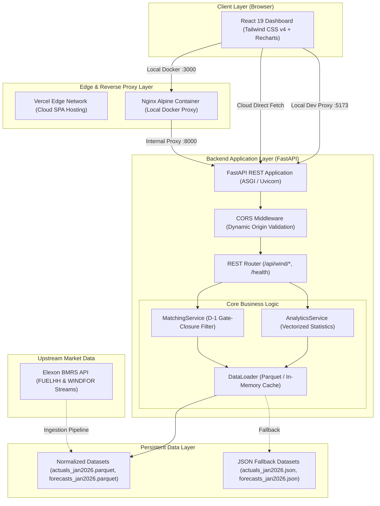

# Gridbricks System Architecture & Technical Design

**Document Version:** 1.0.0  
**Scope:** Full-Stack Architecture, Data Pipeline, Matching Logic & Component Interaction  

---

## 1. High-Level System Architecture

Gridbricks is structured as a decoupled, asynchronous, containerized full-stack application:

---

## 2. Temporal Gate-Closure Matching Logic

In UK wholesale electricity trading, bids for delivery day $D$ close at the Day-Ahead auction deadline (typically 12:00 UTC on day $D-1$). To eliminate lookahead bias:

### 2.1 Cutoff Window Formulation
For target delivery date $D$, the decision gate closure cutoff timestamp is:
$$\text{Cutoff} = (D - 1)\text{ at } H_{\text{cutoff}}\text{ (default 12:00:00 UTC)}$$

### 2.2 Selection Algorithm
1. Filter all historical forecast publication runs:
   $$\text{Eligible Runs} = \{ r \in \text{WINDFOR} \mid r.\text{publish\_time} \le \text{Cutoff} \}$$
2. For each target delivery hour $H \in [0, 23]$ of date $D$:
   - Identify candidate forecast records targeting hour $H$.
   - Select the record with the maximum `publish_time`.
   - If two candidate records share the exact same `publish_time`, deterministic tie-breaking selects the record with the latest update/record ID.

---

## 3. Dual-Grain Rate Mapping (Hourly to Half-Hourly)

- **Actual Generation (`FUELHH`):** Reported in 30-minute settlement periods ($p \in [1, 48]$).
- **Forecast Generation (`WINDFOR`):** Reported in 60-minute target delivery intervals ($H \in [0, 23]$).

Because power (MW) is an instantaneous rate of energy flow (megajoules per second), an expected average rate of $G$ MW over hour $H$ applies directly to both Settlement Period $2H+1$ and $2H+2$. We preserve original publication metadata and do not invent artificial linear interpolation between adjacent hours.

---

## 4. Statistical Metrics Formulation

All calculations are vector-accelerated using pandas and NumPy:

- **Signed Error:** $e_i = F_i - A_i$ (positive indicates over-forecast, negative indicates under-forecast).
- **Mean Absolute Error (MAE):** $\text{MAE} = \frac{1}{N} \sum_{i=1}^N |e_i|$
- **Root Mean Squared Error (RMSE):** $\text{RMSE} = \sqrt{\frac{1}{N} \sum_{i=1}^N e_i^2}$
- **Mean Bias Error (MBE):** $\text{Bias} = \frac{1}{N} \sum_{i=1}^N e_i$
- **Weighted Absolute Percentage Error (WAPE):**
  $$\text{WAPE} = \frac{\sum |e_i|}{\sum A_i} \times 100\% \quad (\text{returns } 0.0\% \text{ if } \sum A_i = 0)$$
- **Quantiles (P10, P50, P90):** Calculated over $e_i$ using linear percentile interpolation.
- **Diurnal Profile:** Settlement period-level average of $e_i$ and $|e_i|$ across days for $p \in [1, 48]$.
- **Peak / Off-Peak Partition:**
  - Peak: Settlement Periods 15 to 38 (07:00 to 19:00 UTC).
  - Off-Peak: Settlement Periods 1 to 14 and 39 to 48.

---

## 5. Concurrency & Frontend State Management

In [`frontend/src/App.tsx`](../frontend/src/App.tsx), race conditions caused by rapid consecutive filter clicks are eliminated using a monotonic request sequence counter (`useRef<number>(0)`):
- When a fetch starts, the request ID increments.
- When an async fetch resolves, the component checks if `currentRequestId === latestRequestId`. If stale, the response is discarded.
