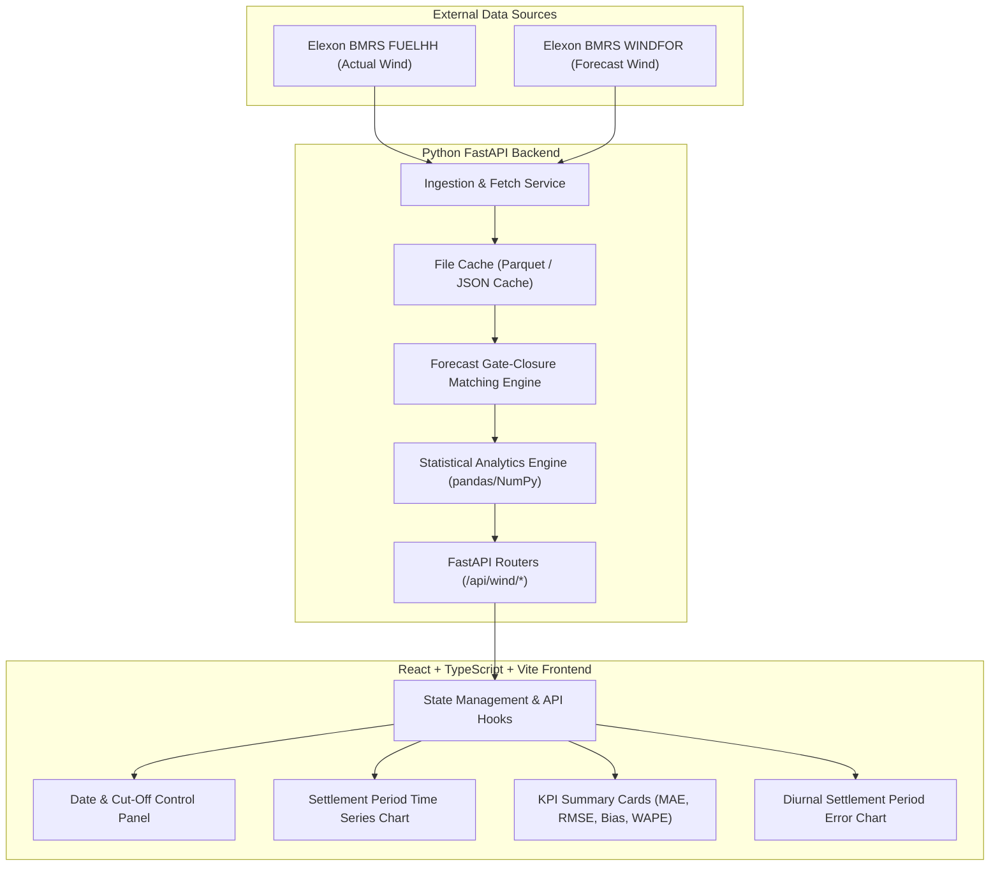

# Gridbricks Full-Stack SWE Challenge: Project Master Plan

## 1. Executive Summary & Business Context

### 1.1 The Client & Problem Statement
The client is a UK energy utility operating in the wholesale electricity market. Their power procurement desk is responsible for purchasing electricity on the UK Day-Ahead Market (DAM) to reliably cover consumer electricity demand.

To minimize procurement costs and decarbonize their supply, the utility prioritizes renewable wind generation. Because wind generation is intermittent and weather-dependent, the desk must rely on generation forecasts to determine how much residual power must be procured from dispatchable thermal sources (e.g., combined-cycle gas turbines) one day prior to delivery ($D-1$).

### 1.2 The Operational Challenge
In the UK market:
- The day is divided into **48 half-hour Settlement Periods** (Period 1: 00:00–00:30 UTC, through Period 48: 23:30–00:00 UTC).
- Day-ahead power purchase decisions for delivery day $D$ are finalized on day $D-1$ before auction closure (typically between 11:00 and 12:00 UTC).
- Forecasts published *after* the decision cutoff cannot be used for day-ahead purchasing decisions.
- Over-forecasting wind leaves the utility short, triggering costly imbalance cash-out penalties to procure emergency power. Under-forecasting wind results in over-procuring thermal power and dumping excess power at discounted spill prices.

### 1.3 Solution Objective
Build a production-grade, containerized web application (React frontend + Python FastAPI backend) that:
1. Reconstructs and visualizes the exact wind generation forecast available to traders at their day-ahead decision cutoff for any delivery day in **January 2026**.
2. Compares the day-ahead forecast against actual outturn generation across all 48 settlement periods.
3. Quantifies forecast accuracy with industry-standard statistical metrics (MAE, RMSE, Mean Bias Error, WAPE/MAPE, error distributions) to inform risk buffers and thermal procurement decisions.

---

## 2. Functional Requirements

### 2.1 Data Ingestion & Scope
- **Data Source:** Exclusively Elexon BMRS (Balancing Mechanism Reporting Service) APIs.
  - **Actual Wind Generation:** `FUELHH` stream (`fuelType == "WIND"`, fields: `startTime`, `generation`).
  - **Forecast Wind Generation:** `WINDFOR` stream (fields: `startTime`, `publishTime`, `generation`).
- **Temporal Scope:** January 2026 delivery dates (2026-01-01 through 2026-01-31) and corresponding day-ahead decision windows (late December 2025 through January 2026).

### 2.2 Forecast Selection Logic (Gate Closure Matching)
- For each target delivery day $D$ and each settlement period $p \in [1, 48]$:
  - Define the decision cutoff timestamp on day $D-1$ (default: 12:00 UTC on $D-1$, configurable via UI).
  - Select the latest forecast record for that target half-hour where $\text{publishTime} \le \text{decision cutoff}$.
  - Strictly prevent lookahead bias (no forecasts published after the cutoff may be included in the day-ahead baseline).

### 2.3 Visual Comparison
- Interactive time-series display showing:
  - Decision-time Day-Ahead Wind Forecast (MW).
  - Actual Wind Generation Outturn (MW).
  - Absolute/Signed Variance (Delta MW) across half-hourly settlement periods.
- Date navigation across January 2026 (single-day 48-period view and multi-day / full-month trend view).

### 2.4 Quantitative Accuracy & Error Analytics
- Calculate standard quantitative metrics across selected periods and full month:
  - **MAE (Mean Absolute Error):** $\frac{1}{N} \sum |F_i - A_i|$
  - **RMSE (Root Mean Square Error):** $\sqrt{\frac{1}{N} \sum (F_i - A_i)^2}$
  - **Mean Bias Error (MBE):** $\frac{1}{N} \sum (F_i - A_i)$ (indicates systemic over- or under-forecasting)
  - **WAPE (Weighted Absolute Percentage Error):** $\frac{\sum |F_i - A_i|}{\sum A_i}$ (avoids division-by-zero on low generation)
  - **Error Distribution & Percentiles:** P10, P50, P90 forecast error values.
  - **Diurnal / Settlement Period Profile:** Breakdown of average error by settlement period (1–48) to reveal peak vs. off-peak forecast performance.

---

## 3. Technical Requirements & Deliverables

### 3.1 Technology Stack
- **Frontend:** React 18+ with TypeScript, Vite build tool, Tailwind CSS for styling, and an interactive charting library (e.g., Recharts).
- **Backend:** Python 3.11+ / 3.14 with FastAPI, Pydantic v2 for data schemas, and pandas/NumPy for statistical processing.
- **Containerization:** Docker (`Dockerfile` for backend, `Dockerfile` for frontend, unified `docker-compose.yml`).
- **Testing:** Pytest for backend unit/integration tests; Vitest / React Testing Library for frontend component tests.
- **CI/CD:** GitHub Actions workflow running linting, formatting checks, and test suites.

### 3.2 Deliverables Checklist
1. **GitHub Repository:**
   - Anonymous repository name (e.g., `energy-dam-forecast-7x2`).
   - Clean commit history following conventional commits.
   - Clear `README.md` containing:
     - Architecture overview and directory layout.
     - Local setup instructions (Docker Compose and native execution).
     - Links to deployed application.
     - Explicit disclosure of AI tooling used during development.
2. **Cloud Deployment:**
   - Frontend deployed on Vercel.
   - Backend API deployed on cloud host (Render, Railway, or Heroku).
   - Verified live in incognito mode without authentication barriers.
3. **Video Demonstration (Max 10 minutes, unlisted YouTube link):**
   - **Part 1 (≤ 5 min): Customer Pitch:** Present to the utility client—demonstrate the decision-support dashboard, explain the business value, walk through January 2026 findings and risk hedging recommendations.
   - **Part 2 (≤ 5 min): Tech Lead Review:** Present architecture, Elexon data pipeline, gate-closure selection algorithm, code structure, test coverage, Docker configuration, and key design decisions.
4. **Submission Form:**
   - Form filled with repo link, live deployment URL, and video link.

---

## 4. Recommended Architecture

### 4.1 Layer Responsibilities
- **Frontend Layer:**
  - `src/components/`: Modular UI widgets (Charts, Metrics, Controls, Error Banners).
  - `src/services/`: Typed API client with error handling.
  - `src/types/`: TypeScript interfaces matching backend Pydantic schemas.
- **Backend Layer:**
  - `app/api/`: REST endpoints with clear OpenAPI documentation.
  - `app/services/`: Pure business logic (Elexon client, forecast selector, metric calculations).
  - `app/models/`: Pydantic validation schemas.
  - `app/core/`: Configuration, logging, exception handlers.
- **Data & Caching Strategy:**
  - The January 2026 dataset consists of 1,488 half-hour settlement periods for actuals, and corresponding forecast publication snapshots.
  - A heavy external database (PostgreSQL, Redis) is unnecessary and adds operational failure modes for this scope.
  - **Recommended Approach:** A deterministic local file cache (structured Parquet or pre-indexed JSON) with an in-memory FastAPI cache. Data is fetched once from Elexon, validated, normalized, and cached locally. Subsequent API requests resolve in sub-10ms without hitting Elexon rate limits or experiencing third-party latency.

---

## 5. Major Implementation Phases & Dependencies

```mermaid
flowchart LR
    P1["Phase 1: Step 1 Inspection & Master Plan"] --> P2["Phase 2: Elexon Data Exploration & Pipeline"]
    P2 --> P3["Phase 3: Backend Matching & Analytics Engine"]
    P3 --> P4["Phase 4: Frontend Trading Dashboard"]
    P4 --> P5["Phase 5: End-to-End Testing & Hardening"]
    P5 --> P6["Phase 6: Docker Containerization"]
    P6 --> P7["Phase 7: Cloud Deployment (Vercel + Render/Railway)"]
    P7 --> P8["Phase 8: Video Demo, README & Final Submission"]
```

| Phase | Description | Pre-requisites | Output |
| :--- | :--- | :--- | :--- |
| **Phase 1 (Step 1)** | Project inspection, environment checks, master plan & progress tracker. | None | Master Plan, Progress Tracker, approved roadmap. |
| **Phase 2 (Step 2)** | Elexon API investigation, schema exploration, data fetching script & local cache. | Phase 1 | Clean cached dataset for Jan 2026 actuals & forecasts. |
| **Phase 3 (Step 3)** | Backend service architecture: gate-closure matching, statistical calculations, FastAPI endpoints & tests. | Phase 2 | Tested FastAPI endpoints with Swagger docs and unit tests. |
| **Phase 4 (Step 4)** | Frontend implementation: React, Vite, TypeScript, Tailwind, Recharts, controls. | Phase 3 | Polished interactive UI consuming backend API. |
| **Phase 5 (Step 5)** | Integration testing, edge-case handling (DST, missing intervals, zero wind), error states. | Phase 4 | Full test coverage (Pytest + Vitest) passing cleanly. |
| **Phase 6 (Step 6)** | Dockerization: Dockerfiles, docker-compose.yml, container spin-up and health check validation. | Phase 5 | One-command local container execution. |
| **Phase 7 (Step 7)** | Cloud deployment: Vercel frontend, backend hosting, environment configuration, incognito testing. | Phase 6 | Public live URLs verified working. |
| **Phase 8 (Step 8)** | Presentation: Anonymous GitHub repo, comprehensive README, 10-minute video presentation script, submission form. | Phase 7 | Submission-ready project with video and docs. |

---

## 6. Core Acceptance Criteria

1. **Forecast Cut-Off Integrity:** For any selected delivery day in Jan 2026, the application must use only forecasts with `publishTime <= decision cutoff` (e.g. 12:00 on $D-1$). No future data leakage.
2. **Settlement Period Completeness:** All 48 half-hour settlement periods are mapped and accounted for on any valid delivery date.
3. **Statistical Accuracy:** MAE, RMSE, Mean Bias Error, and WAPE match mathematical definitions and are verified with automated unit tests against known fixtures.
4. **Reproducibility:** The application boots cleanly via `docker compose up` without manual dependency intervention.
5. **Deployment:** The frontend and backend are publicly accessible on the web, responding with sub-second latency.
6. **Video Demo Quality:** Clear two-part structure (≤ 5 min client pitch, ≤ 5 min tech review), strictly under 10 minutes total.

---

## 7. Potential Risks, Assumptions & Unresolved Questions

### 7.1 Risks & Mitigations
- **Risk:** Elexon BMRS API rate limits, temporary outages, or slow responses.
  - *Mitigation:* Ingest and cache validated January 2026 data into local Parquet/JSON artifacts so the running application never fails due to third-party API downtime.
- **Risk:** Missing half-hour settlement periods or data anomalies in actual generation.
  - *Mitigation:* Data pipeline explicitly validates all 48 settlement periods per day, flagging missing slots with clear UI indicators rather than crashing.
- **Risk:** Docker daemon is not currently running on the development workstation.
  - *Mitigation:* Develop and verify natively first, then start Docker Desktop to test containerized builds before final deployment.

### 7.2 Key Assumptions
- Day-ahead purchase decision cutoff is defaulted to 12:00 UTC on day $D-1$, aligned with standard UK day-ahead auction timing (EPEX SPOT / Nord Pool), with UI flexibility to inspect other cutoffs.
- Timezone is treated consistently in UTC, as standard for UK wholesale power settlement (Elexon BMRS reports in UTC).

---

## 8. Future Advanced Features (Deferred Beyond Core)

*These features will be evaluated only after all core requirements are fully implemented, verified, and tested.*

1. **Thermal Procurement Hedging Calculator:**
   - Direct calculation of thermal power to purchase: $\text{Thermal} = \text{Demand} - \text{Wind Forecast} + \text{Risk Buffer}$.
   - User inputs demand profile and target risk tolerance (P90/P95) to output required MW hedging.
2. **Interactive Decision Cut-Off Scrubber & Lead-Time Decay:**
   - UI slider allowing real-time inspection of how forecast error decreases as decision cutoff moves from $D-1$ 08:00 to $D-1$ 12:00 to within-day.
3. **2D Diurnal Settlement Heatmap:**
   - 31 days $\times$ 48 settlement periods color-coded matrix highlighting specific high-volatility event windows.
4. **Financial Imbalance Cost Simulator:**
   - Conversion of MW forecast error into estimated cash penalties using proxy UK system imbalance prices.
5. **AI Operational Briefing Summary:**
   - Structured executive commentary summarizing key weather events and forecast biases for trading desks.
